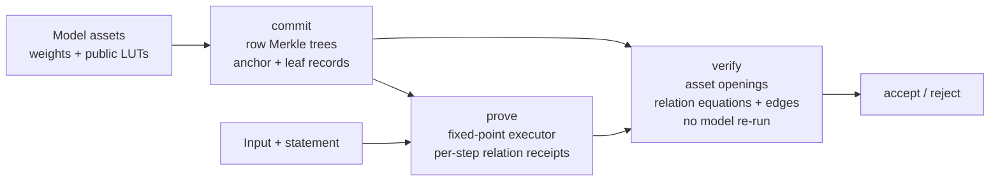

# zkIE

**Verifiable fixed-point inference with a three-stage commit / prove / verify
pipeline.**

> Status: under development. The current implementation supports GPT-2 124M,
> Gemma 3 270M and TimesFM 1.0 200M. Proofs are not zero-knowledge: weights,
> lookup tables and activations are public witness data.

zkIE proves that the output of a committed model on a public input is exactly
the fixed-point result of running that model. The verifier checks the statement,
the public model commitment and the proof; it never re-runs the model and never
reads the model weights.

## What is proven

For a statement `(model_commitment, input, expected_output)` and an optional
expected token choice, the prover shows:

- the statement is bound to the public model commitment and to the input;
- every weight and lookup table read by the execution is an opening of the
  committed model;
- every operator step satisfies its algebraic relation on the opened inputs,
  outputs and intermediate vectors;
- data flows between steps match the declared producer/consumer edges;
- the final output, or the final token choice, equals the statement's expected
  value.

The verifier accepts only when all of the above checks pass.

## Pipeline



### commit

The commit stage reads the model's weight and lookup-table assets, hashes their
rows into Merkle trees, and builds a shared model commitment:

- each asset is described by `asset_id`, path, element count, row width and
  encoding (`i32-le` or `i64-le`);
- rows are hashed into leaves; the leaves form a per-asset Merkle tree;
- a `LeafRecord` binds the table identity and the tree root;
- an `AnchorRecord` binds the model commitment, the parameters digest and all
  leaf records;
- `ModelCommitmentPublic` carries only the anchor and per-asset metadata, not
  weight values.

The commit artifact contains the public model commitment, the provider
configuration, the protocol description and a private parameters file. The
verifier needs only the public part.

### prove

The prove stage consumes an existing commit artifact, re-opens the committed
assets by `(asset_id, row range)`, and executes the model's fixed-point
executor. Every operator step produces a relation receipt:

- the opcode and its relation configuration (dimensions, shifts, clamps, table
  descriptors);
- an oracle registry containing the Merkle roots used by the step;
- committed input, output, raw-accumulator, quotient, range-helper and
  auxiliary vectors, each opened with Merkle paths;
- a mapping from selected inputs to the shared asset pool, so a weight or LUT
  interval is committed once per trace and referenced by later steps;
- a mapping from local inputs to earlier step outputs.

The serialized `SharedTrace` (tokens, asset openings, steps, final argmax and
final output) is the proof.

### verify

The verify stage loads the public model commitment, the statement, the proof
and the public inputs. For every asset opening it checks the link proof to the
anchor and the Merkle path of every opened row. For every step it rebuilds the
oracle registry, checks the op-specific relation on the opened values, and
checks the producer/consumer edges. Finally it checks the claimed argmax or
output tensor. The operator's forward routine is never called.

## Shared model commitment and public LUTs

Weights and lookup tables use the same commitment path. A LUT is an asset like
any other: its rows are committed at commit time, opened once per trace, and
referenced as an external input by the steps that read it. The verifier checks
the opening against the same anchor and Merkle root as a weight opening, so a
prover cannot substitute a different table.

## Supported operators

The live executors use these operators:

`add`, `affine_scale`, `argmax`, `gated_ffn`, `hadamard`, `index_gen`,
`matmul`, `projection`, `profile_norm`, `profile_rms`, `profile_rope`,
`profile_standardize`, `relu`, `softmax`, `softmax_rows`, `table_lookup`.

Each operator has a fixed-point forward implementation and an algebraic
relation checked by the verifier over opened vectors. Integer rounding uses an
explicit shift and mathematical floor; no host floating point participates in
the witness.

## Models

| Model | Input shape | Executor |
| --- | --- | --- |
| GPT-2 124M | 16 or 512 tokens | `models/gpt2` |
| Gemma 3 270M | 16 or 512 tokens | `models/gemma3` |
| TimesFM 1.0 200M | 16 patches from 512 raw points | `models/timesfm` |

Model weights and lookup tables are external, gitignored assets under each
model's `weights/` directory. `scripts/` contains the extraction and
fixed-point simulation helpers used to produce them. The model crates contain
only the fixed-point configuration and the shared-trace executor.

## Run it

Build and test the workspace:

```bash
cargo build --workspace
cargo test --workspace
```

Run the three stages with `zkie`:

```bash
# commit: build and publish the shared model commitment
cargo run --release -p zkie -- commit \
  --case <case.toml> \
  --assets-manifest <assets-manifest> \
  --parameters <parameters.bin> \
  --out <commit-dir> \
  --run-dir <run-dir>

# prove: execute the committed model and write the proof
cargo run --release -p zkie -- prove \
  --commit <commit-dir> \
  --input <input.bin> \
  --model-id <model-id-hex> \
  --out <proof-dir> \
  --run-dir <run-dir>

# verify: check the public commitment, statement and proof
cargo run --release -p zkie -- verify \
  --public <commit-dir>/public \
  --statement <proof-dir>/statement.bin \
  --proof <proof-dir>/proof.bin \
  --public-inputs <proof-dir>/public-inputs.bin \
  --model-id <model-id-hex> \
  --policy <policy-file> \
  --run-dir <run-dir>
```

`zkie run` performs commit, prove and verify in one command; see
`zkie help` for its flags. `matrix`, `decode-matrix` and
`profile-matrix` repeat the same stages over case lists and record per-stage
measurements.

`zkie-check` validates supporting material:

```bash
cargo run --release -p zkie-check -- contract --scope <scope> --matrix <matrix>
cargo run --release -p zkie-check -- assets --root <asset-root> --cases <case.toml>... --out <report>
cargo run --release -p zkie-check -- report --input <run-dir> --require-profile <name>
```

## Verification boundary

- **No witness hiding.** Weights, lookup tables, activations and intermediate
  vectors are public in the proof.
- **Hash-based commitments.** Commitment nodes and transcripts use
  domain-separated hashes; the field layer provides Goldilocks base-field and
  cubic-extension arithmetic for kernel primitives.
- **Operator policy.** The verifier takes a policy fixed outside the proof
  bundle. For each case the policy records the input shape, the expected anchor
  identity and the expected model identity; the verifier rebuilds the model
  data-flow plan, asset table identities and anchor from trusted model
  specifications, then checks the proof against them.
- **No model re-execution.** Verification reads the public commitment, the
  statement, the proof and the public inputs only.
- **Performance.** Current commit/prove/verify timings, peak memory and proof
  sizes are **TBD** (to be measured); no performance figures are recorded in
  this document.

### Anchor registration

`zkie anchor` registers a case input and the model asset set on the operator
side:

```bash
cargo run --release -p zkie -- anchor \
  --case <case.toml> \
  --input <input.bin> \
  --asset-root <asset-root> \
  [--asset-hashes <previous-anchor.json>] \
  [--policy <case.policy>] \
  [--out <anchor.json>]
```

It selects the case entry whose declared input path matches `--input`,
validates the input shape, reads every asset through the trusted model
specifications, rebuilds the complete commitment with the commit algorithm and
prints `anchor_id`, `model_id`, `parameters_digest`, the specification
version and audit counters. It never reads a proof bundle. The output includes
a per-asset file SHA-256 list taken from the same mapping that builds the
commitment. The first registration establishes a self-built change-detection
baseline, not an independent attestation of the model weights; pass a previous
anchor output as `--asset-hashes` to compare item by item on later runs, and
`--policy` to check the registered policy against the recomputed identities.
The printed identities are what the operator fixes into `case.policy`; a
policy is trusted only when the registration is performed and attested outside
the prover's bundle.

### Verification policy

`verify`, `run` and `matrix` read the policy from a file fixed by the
operator outside the proof bundle. `--policy` is mandatory and carries trusted
content; there is no lenient default path, and old invocations migrate to the
new contract. The file is strict TOML; unknown fields and duplicate keys are
rejected.

```toml
policy_version = 1
model = "gpt2"
model_version = 1

[[case]]
case_id = "gpt2-seq16"
sequence_length = 16
anchor_id = "<32-byte hex>"
model_id = "<32-byte hex>"
output_mode = "expected"
expected_output_sha256 = "<32-byte hex>"
output_digest_algorithm = "sha256"
output_type = "argmax"
output_encoding = "i32-le"
output_elements = 16
```

Every gpt2 case entry also carries a versioned limited output-head table
identity:

```toml
[case.limited_table_identity]
version = 1
model = "gpt2"
model_version = 1
case_id = "gpt2-seq16"
anchor_id = "<32-byte hex>"
model_id = "<32-byte hex>"
asset_id = <asset id>
asset_table_identity = "<32-byte hex>"
table_root = "<32-byte hex>"
table_record_digest = "<32-byte hex>"
table_configuration = "<32-byte hex>"
code_log_n = <log n>
code_ell = <ell>
code_r = <r>
table_v = <v>
answers = <answers>
salt_bytes = <salt bytes>
distance_radius = <radius>
distance_later_radius = <later radius>
distance_m_once = <m once>
distance_m_later = <m later>
matrix_rows_log = <matrix rows log>
k_lo = <low column bits>
k_col = <column bits>
protocol_identity = "<32-byte hex>"
```

The identity is required for every gpt2 entry and rejected for the other
models. It is a canonical, domain-separated digest over the old
model/anchor/asset side and the committed table's root, record digest,
configuration, shape and mapping. The table root and record are produced by
commit, so the operator provisions the entry after commit from the committed
public reader and record and writes the policy copy that prove and verify
consume. A proof's self-reported roots cannot replace the policy value, and a
new table is rejected until the policy names it. A policy generated by the
prover is not an independent anchor: policy distribution and anti-rollback are
deployment trust assumptions. The checked-in entry pins a fixed-material
provisioning commit; a production deployment must run its own commit and update
the policy.

For the time-series model, replace `sequence_length` with
`raw_input_length = 512`, `patch_tokens = 16` and `output_type` with
`int_output`. `anchor_id` and `model_id` are the trusted anchor identity and
input-bound model identity; both are checked against the commitment and
against the input commitment recomputed from the statement tokens.
`expected_output_sha256` is the registered output file digest; verification
compares the full canonical output bytes with it. To run a policy without an
expected output, set `output_mode = "none"` and omit the output digest, type,
encoding, algorithm and element fields; verification then returns the
authenticated computed output without claiming a user expectation. `run` and
`matrix` copy the policy into the run directory and record its path, SHA-256 and
registration time in `policy-source.json`; they never fill expected values or
identities from the pending bundle. `matrix` expects its policy next to the
case file as `case.policy`.

## License

Apache-2.0. See [`LICENSE`](LICENSE).
